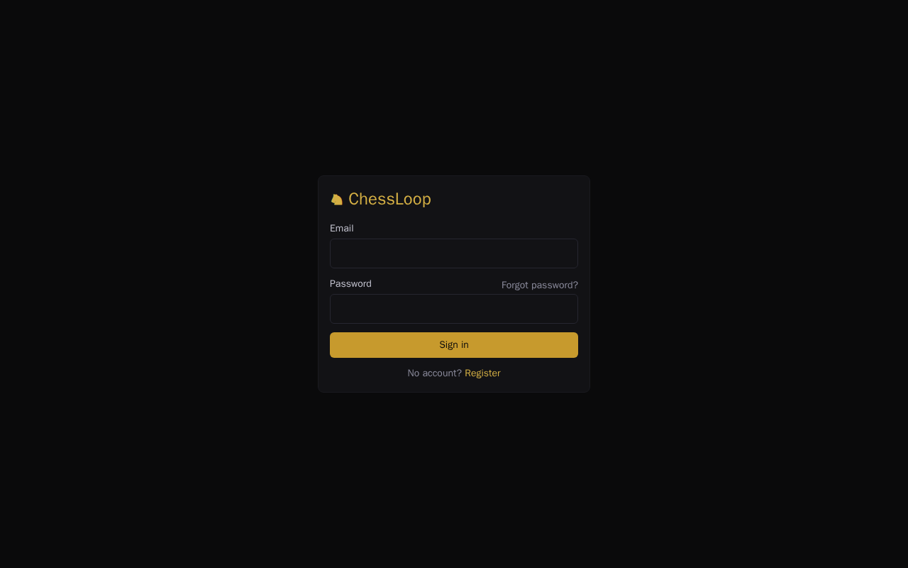
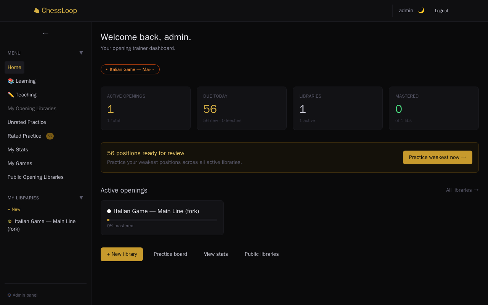
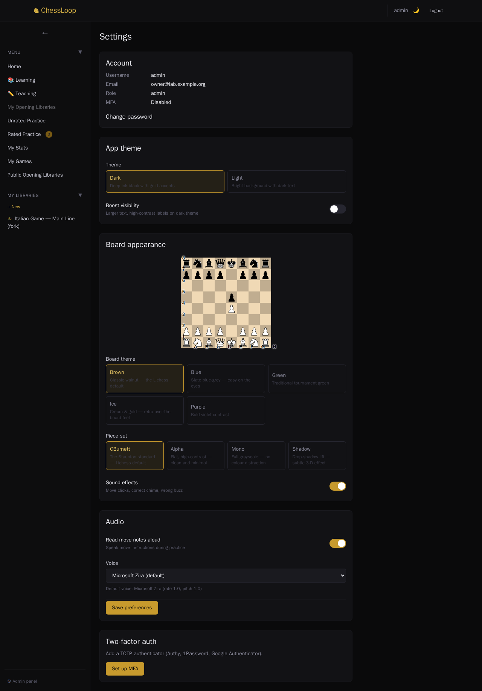
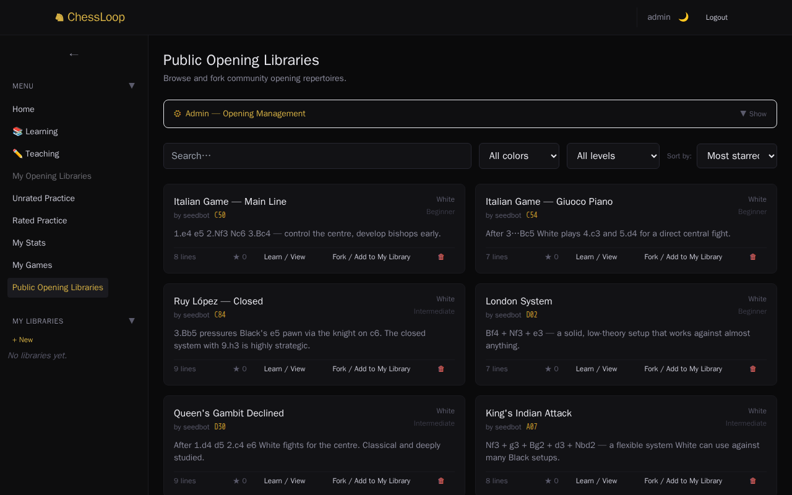
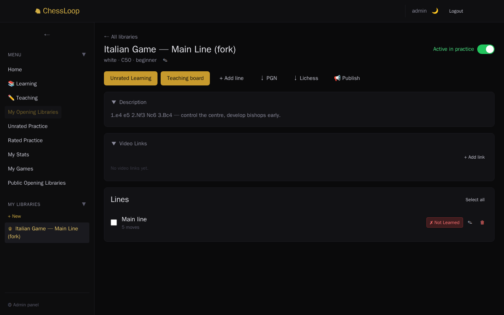
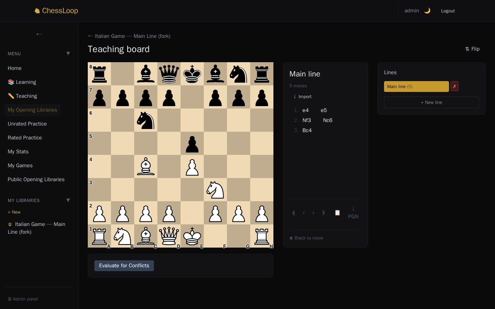
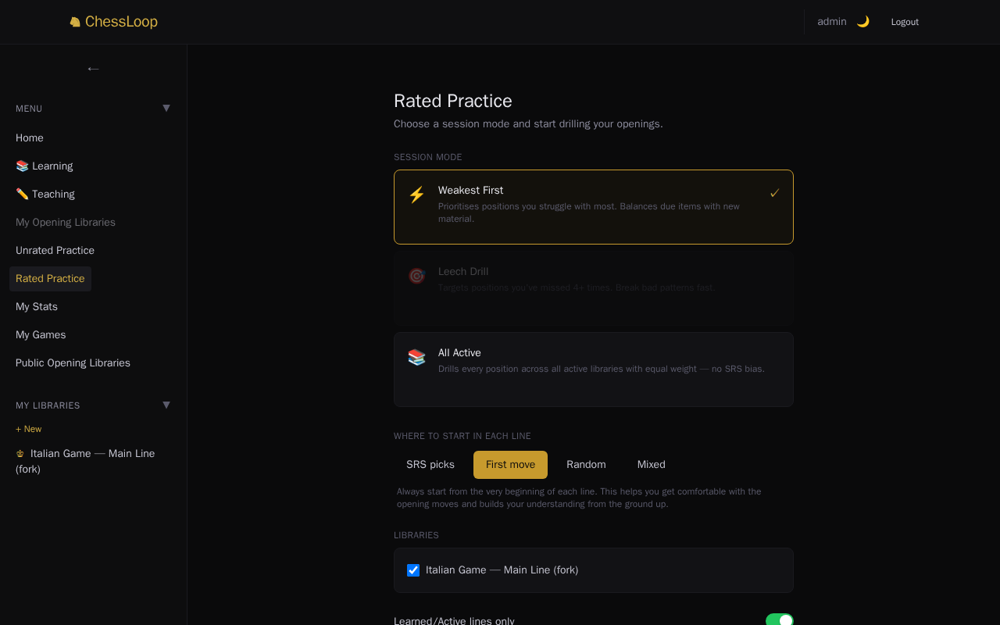
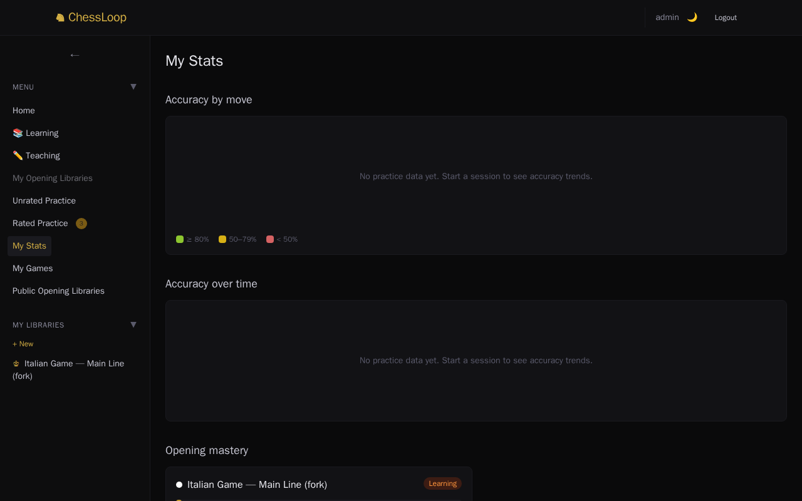
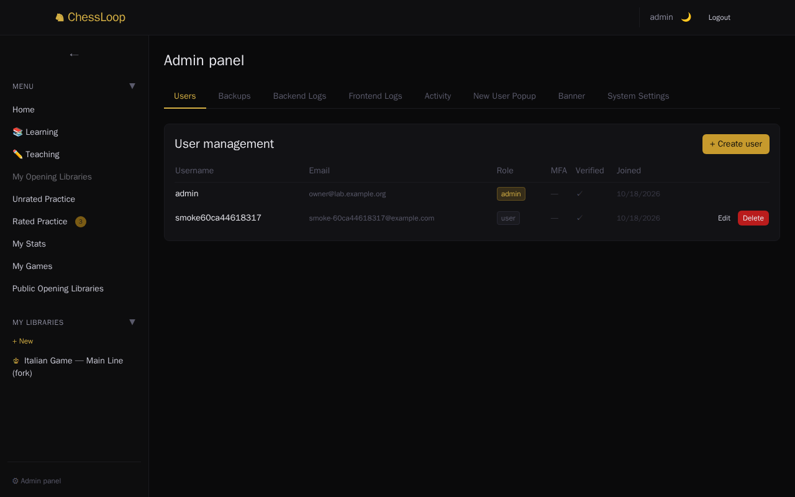

# Using ChessLoop

This guide covers your first hour: sign in, make your account safe, learn a line, practise it and see your progress. It assumes ChessLoop is installed (see the [install guides](../README.md#guides)).

ChessLoop works like this:

1. **Teach** it an opening by playing the moves on a board.
2. **Practise.** It asks you for the right move. Wrong answers come back sooner; right ones come back later. This is called *spaced repetition*.
3. **Check your stats** to see which openings you know and which still break you.

## 1. Sign in

Open `http://localhost:8090` (or the address the installer printed). Sign in with the admin email and password from the install.

The **dashboard** shows what is due today.

The menu on the left takes you everywhere: **My Opening Libraries**, **Unrated Practice**, **Rated Practice**, **My Stats**, **My Games** and **Public Opening Libraries**. Admins also see **Admin panel** at the bottom.

## 2. Change your password

1. Open **Settings** (click your name at the top).
2. Under **Account**, choose **Change password**.
3. Type your current password, then the new one twice. It needs at least 12 characters and must not be built on a common word. A few unrelated words work well.

This signs you out on every other device. If you forget your password and email is off, ask the admin: in **Admin panel → Users** they can set a new one. "Forgot password" by email only works when [email is set up](configuration.md#email).

## 3. Turn on two-factor sign-in (optional)

*Two-factor authentication* (MFA) asks for a six-digit code from an app on your phone each time you sign in. It protects your account even if someone learns your password.

1. In **Settings**, find **Two-factor auth** and follow the steps. You scan a square code with an authenticator app (for example Google Authenticator or Aegis).
   - **Can't scan it?** (The app is on this same computer, or the camera does not work.) Choose **Can't scan? Enter manually** under the square code. It shows a secret key. Type that key into your app.
2. Type the six-digit code the app shows to confirm.

There are no recovery codes. To turn MFA off later, use **Remove MFA** in Settings, which asks for a code from your app. Keep your phone safe: if you lose the app, ask whoever runs your ChessLoop for help.

## 4. Invite family and friends

Send them your ChessLoop address. They choose **Register** on the sign-in page, enter an email, a username and a password.

- **Email off (the default):** new people can sign in right away. You can see and manage everyone in **Admin panel → Users**.
- **Email on:** new people must click a link in an email first. The links use the address in `FRONTEND_URL` ([Configuration](configuration.md#frontend_url)).

Only people who can reach your ChessLoop can register. At home, that is people on your network. Do not put ChessLoop on the internet: see [Not covered](../README.md#not-covered-hosting-chessloop-on-the-internet).

## 5. The starter libraries

The installer loaded 16 starter opening libraries (Ruy López, Sicilian, Italian and more). Each one holds several named lines, such as "Chigorin" or "Breyer" under Ruy López — Closed, 127 lines in all. They come with ChessLoop, so you do not need a Lichess account. Find them under **Public Opening Libraries**.

- **Learn / View** opens one read-only.
- **Fork / Add to My Library** makes your own copy. You can change a copy, and practise it.

Accounts that people register later (for example your family) also get a copy of "Ruy López — Closed" with all its lines. It is in their own libraries; the other 15 stay under **Public Opening Libraries** until they fork them. The first account, the admin the installer made, starts with no libraries of its own. The first time it signs in, ChessLoop shows a one-time message that says so: fork one from **Public Opening Libraries**, or make your own (next section).

## 6. Look at a library, then teach a line

Open **My Opening Libraries** and click a library. If you have none yet, fork one from **Public Opening Libraries**, or click **+ New** under **My Libraries** in the menu to make an empty one.

- The switch **Active in practice** decides whether its lines come up in practice.
- **+ Add line** adds an empty line named like "Opening Line [9]". Double-click the name to rename it, then open the **Teaching board** to record its moves.
- Each line shows **✗ Not Learned** until you mark it. Click it to mark the line **✓ Learned**. It also becomes Learned the first time you play its first move correctly in practice. [Practice](#7-practise) explains why this matters.
- **Unrated Learning** is a read-only viewer to study the moves.
- **Teaching board** is where you record moves.

### The teaching board

On the **Teaching board**, drag pieces to play the moves of your opening. Each move is saved to the line.

| Control | What it does |
|---|---|
| Drag a piece, or click it and then click the square | Records a move. |
| ⟪ ‹ › ⟫ | First move, previous, next, last. |
| ↓ PGN | Downloads the line as a standard PGN file for other chess programs. |
| ⧭ (on a line) | Duplicates the line. |
| 🗑 (on a line) | Deletes the line. It asks first. |
| Double-click a line name | Renames it. |
| **Flip** | Shows the board from Black's side. |

**Move notes.** Click a move in the list, choose **Add note**, type, and press `Ctrl` + `Enter` to save (`Esc` cancels). Notes show in the teaching board, in Unrated Learning and in practice.

**Unrated Learning** is read-only: you can step through moves, read notes, flip the board and export PGN, but cannot change anything. Use it to review before you practise.

## 7. Practise

There are two kinds:

- **Rated Practice** schedules your reviews. Use this daily.
- **Unrated Practice** is free play that does not change your schedule.

Open **Rated Practice**. Choose a session mode:

| Mode | What it does |
|---|---|
| **Weakest First** | Picks the positions you struggle with most, mixed with some new ones. |
| **Leech Drill** | Only positions you have missed four or more times (*leeches*). |
| **All Active** | Every position in your active libraries, equally. |

Choose where each line starts (**First move** is the gentlest), tick the libraries, and start. ChessLoop shows a position. Play the move you have learned.

> **Your first session.** The switch **Learned/Active lines only** is on at first, so only lines marked **✓ Learned** come up. A new line is **✗ Not Learned**, so ChessLoop says "No lines are marked Learned yet". Do one of these: turn the switch **off** and start again, or mark the line **✓ Learned** in its library (see [section 6](#6-look-at-a-library-then-teach-a-line)). The switch is back on each time you open the page.

- **Right:** it goes on, and the position comes back later.
- **Wrong:** the board flashes red and shows the correct move. You must play the right move before going on. The position comes back sooner.

The number next to **Rated Practice** in the menu is how many positions are due.

## 8. Read your stats

**My Stats** shows accuracy by move number, accuracy over time, mastery per opening, leeches and recent sessions. It fills in as you practise.

## 9. Share and discover

In a library, **Publish** puts it in **Public Opening Libraries** for everyone on your ChessLoop. People can star it, comment on it and fork it.

## 10. For admins

The **Admin panel** has tabs for Users, Backups, logs, activity, a banner message and System settings. In **Users** you can create accounts, verify them and set passwords. In **Backups** you create, download and restore backups ([Backup and restore](backup-restore.md)). **System settings** shows whether email is set up. **Openings** can pull extra variations from Lichess once you add a free Lichess token ([how](configuration.md#import-more-variations-from-lichess)); without one it says so and everything else keeps working.

## Appearance

In **Settings** choose the app theme (dark or light), a board theme (Brown, Blue, Green, Ice, Purple), a piece set (CBurnett, Alpha, Mono, Shadow) and sounds. Changes preview straight away.
